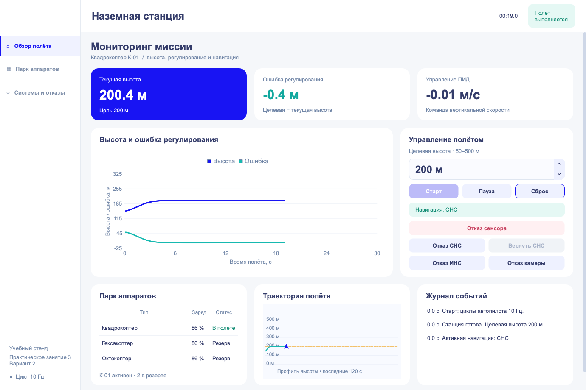

# Практическое занятие 3 — вариант 2

Полная наземная станция управления БПЛА: задания 1, 2 и 3 для варианта 2 и интеграционное задание. Qt Widgets, C++17, Qt Charts. Оформление адаптировано по публичному превью BankDash: белая боковая панель, светлый фон, синие и бирюзовые акценты.

## Скачать и запустить

Скачайте [полный архив с готовым приложением](downloads/Практика_3_Вариант_2.zip) и распакуйте его. Внутри дважды щёлкните **«Запустить станцию.command»** или откройте `bin/GroundStation.app`. Готовая сборка — macOS 13+ на Apple Silicon (arm64); Qt включён внутрь приложения. Интернет для работы не нужен. Для Intel, Windows или Linux пересоберите исходники.

[Отчёт с результатами пяти обязательных сценариев](output/pdf/Отчёт.pdf).



## Как выполнить сценарий

1. При запуске статус **Остановлено**, цель 200 м, текущая высота 150 м. Таблица парка заполнена. Симулируется один квадрокоптер; гексакоптер и октокоптер — резервные аппараты.
2. **Старт** включает таймер 100 мс. Панель, таблица, график и профиль высоты обновляются из одного сигнала `telemetry_updated`. **Пауза** сохраняет состояние; **Старт** продолжает его.
3. Введите 300 м в **«Целевая высота»** и нажмите Enter. Диапазон 50–500 м, шаг 10. Ошибка меняется сразу, со следующего цикла ПИД регулирует высоту. Синяя серия — «Высота», бирюзовая — «Ошибка».
4. **Отказ сенсора** переводит гироскоп в состояние «Не готов». Следующий цикл выдаёт `fault_detected`: красный статус с причиной, запись в журнале, одно окно предупреждения; таймер останавливается. Закройте предупреждение.
5. **Сброс** восстанавливает сенсоры и все источники навигации, продолжает работу с текущей высоты и текущей целью. Состояние ПИД и история сохраняются. Повторный сброс безопасен.
6. **Отказ СНС** переключает навигацию на ИНС при следующем цикле. Индикатор жёлтый, таймер продолжает работать. **Вернуть СНС** восстанавливает приоритет спутниковой навигации. **Отказ ИНС** после отказа СНС позволяет проверить визуальную навигацию; отказ всех трёх источников вызывает аварийную остановку. **Сброс** восстанавливает все источники.

Журнал хранит до 200 событий с временем моделирования. График и след — до 1200 точек (120 с). Маркер и объект следа создаются один раз. В небольшом окне содержимое прокручивается; пункты боковой панели прокручивают к соответствующим блокам.

## Состав проекта

- `src/uav.*` — UAV, Quadcopter, Hexacopter, Octocopter и учебная вертикальная динамика.
- `src/sensor.*` — Sensor, Gyroscope, Accelerometer, Barometer; готовность через `set_ready`.
- `src/navigation.*` — NavigationSystem, спутниковая, инерциальная и визуальная навигация, NavigationManager : QObject с приоритетом источников.
- `src/controller.*` — FlightController, SimpleController и PIDController с ограничением интеграла и выхода.
- `src/autopilot.*` — Autopilot : QObject; `run_cycle`, закрытая цель и публичный `set_target_altitude`, сигналы телеметрии и отказа.
- `src/mainwindow.ui` — оболочка окна для Qt Designer; `src/mainwindow.*` — компоновка панелей, представление, команды и соединения.
- `src/trajectoryview.*` — QGraphicsScene с постоянными маркером, следом и линией цели; это профиль высоты по времени, не географическая карта.
- `assets/style.qss` — оформление; `tests/` — тесты модели и интерфейса.
- `verification/` — пять обязательных сценариев, дополнительные скриншоты, результаты проверок и JSON измерений.
- `output/pdf/Отчёт.pdf` — отчёт с таблицей тестирования, формулами и скриншотами.

В модели нет виджетов, `ui->` и `qDebug`. В окне нет ПИД-формул и алгоритма выбора навигации. Собственные поля закрыты, `connect` использует указатели на методы. Модельные QObject принадлежат окну; остальные модельные объекты — его поля.

## Учебная динамика

ПИД формирует команду вертикальной скорости в м/с, ограниченную ±18 м/с. Параметры: Kp=0.8, Ki=0.015, Kd=0.12. Шаг 0.1 с, постоянная времени привода 0.5 с. Ошибка e=target−altitude; интеграл ограничен ±50 и обновляется условно при насыщении. Все навигационные источники наблюдают одно физическое состояние аппарата, поэтому резерв не вызывает скачка высоты. Сенсоры и навигация имитируются, подключение к реальному БПЛА не выполняется.

## Сборка и тесты

Установлен Qt 6.11.2. Требуются модули Core, Gui, Widgets, Charts, Test; поддерживается Qt 6.5+ и CMake 3.21+.

На этом Mac запустите **«Собрать и проверить.command»**: скрипт находит Qt, собирает проект, запускает оба набора тестов, включает Qt в приложение и сохраняет скриншоты. Путь к Qt можно задать переменной `QT_PREFIX`.

В Qt Creator откройте `Practical_03_GroundStation.pro` или `CMakeLists.txt` и выберите Qt 6 с Charts. Для GUI-тестов используйте `GuiTests.pro`, для модели — `ModelTests.pro`. При проблемах локали qmake используйте папку проекта с латинским именем либо приведённый скрипт.

Общая сборка CMake:

```sh
cmake -S . -B build -DCMAKE_PREFIX_PATH="/путь/к/Qt/6.x/комплекту"
cmake --build build --parallel
ctest --test-dir build --output-on-failure
```

GUI-тесты в CTest используют платформу offscreen и сохраняют скриншоты в `build/verification`. В тестах проверяется реальный таймер; длительная траектория дополнительно прогоняется ускоренными вызовами тех же `run_cycle()` с шагом 0.1 с. Рабочее приложение всегда использует 10 Гц.

## Источники

Задания: «Практика 3 ПО ОНИ.pdf», стр. 1–9. Визуальный ориентир: [BankDash в Figma Community](https://www.figma.com/community/file/1323695683687017923/bankdash-dashboard-ui-kit-admin-template-dashboard-admin-dashboard). Доступ к слоям через Figma ограничен; реализована самостоятельная адаптация по публичному превью, а не точная выгрузка компонентов.

Интерфейс полностью на русском языке. СНС — спутниковая навигационная система, ИНС — инерциальная навигационная система. Подписи GroundStation и «Симуляция БПЛА» удалены из окна.
